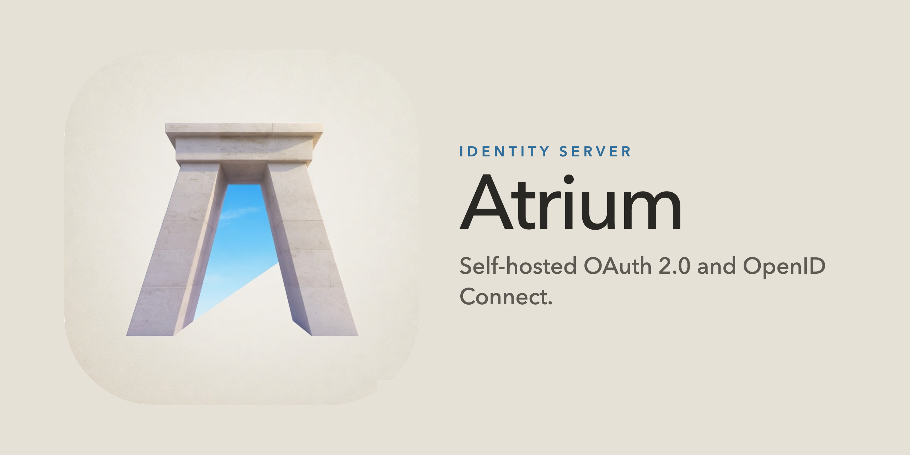

# Atrium



[](https://go.dev/)
[](https://github.com/go-chi/chi)
[](https://modernc.org/sqlite)
[](https://www.postgresql.org/)
[](https://redis.io/)
[](https://www.rabbitmq.com/)
[](https://opentelemetry.io/)
[](docs/DEPLOY.md)
[](https://codecov.io/gh/BRAVO68WEB/atrium)

Atrium is a self-hosted identity server. It speaks OAuth 2.0 and OpenID
Connect. One process serves the protocol, the browser sign-in pages, and the
management API.

## Goals

Run it with a SQLite file and no extra services. `just run` is enough for
local use. Administration is a client-credentials token with the
`management` scope, through `/api` and `atrium-cli`. Postgres, Redis, SMTP,
and traces turn on when you set them.

## Features

- Authorization code with PKCE, client credentials, device code, refresh
  tokens, token exchange, and on-behalf-of delegation to a registered agent
- A paste-the-code page for the out-of-band redirect URNs, and an optional
  combined-code helper at `/oauth/oob`
- CIBA in poll mode, and pushed authorization requests
- OpenID Connect discovery, JWKS, UserInfo, and ID tokens
- Pairwise subjects, and nested encryption for ID tokens and UserInfo when
  a client opts in
- DPoP and mutual TLS client authentication
- TOTP enrollment, browser login, registration, consent, organization
  choice, a signed-in profile at `/profile`, and logout
- Account APIs for the signed-in user, and management APIs for the
  management client
- Dynamic client registration and client ID metadata documents
- Social login, webhooks, audit, and login analytics

Access tokens are opaque unless you set `security.access_token_format` to
`jwt`.

## Quick start

```bash
git clone https://github.com/bravo68web/atrium.git
cd atrium
just run
```

With no `config.yaml`, the server listens on `http://localhost:8080`. When
that file is present, `just run` uses its port and TLS settings.

A `v*` tag publishes release archives and the server image. The image
is `bravo68web/atrium` and `ghcr.io/bravo68web/atrium`, for amd64,
arm64, and arm/v7. See [Deploy](docs/DEPLOY.md).

Postgres install:

```bash
docker compose -f deploy/compose.yaml up --build
```

Change `management.client_secret` in `deploy/config.yaml` before you use
that file anywhere but a laptop. `just run` still uses SQLite.

```bash
just build
./bin/atrium-cli init
```

`init` writes `config.yaml` and `internal/hashalgo/algo.go`. It leaves an
existing file in place unless you pass `--force`.

## Tech stack

| Piece | Role |
| --- | --- |
| Go 1.26 | Server, `atrium-cli`, and `atrium-mobile` |
| chi | HTTP router |
| SQLite | Default database, one open connection |
| Postgres | Optional database, through `database.dsn` |
| Redis | Optional cache and approval queue |
| RabbitMQ | Optional retry queue for webhooks and mail |
| OpenTelemetry | Optional OTLP/HTTP traces |
| Docker | Images on GHCR and Docker Hub |

SQLite needs no extra service. Postgres, Redis, RabbitMQ, and traces
stay off until you set them. See [Deploy](docs/DEPLOY.md).

## Documentation

| Guide | What it covers |
| --- | --- |
| [Configuration](docs/CONFIG.md) | Config file, keys, mail templates, hashing |
| [Deploy](docs/DEPLOY.md) | Process, TLS, Postgres, Redis, SMTP, traces |
| [Branding](docs/BRANDING.md) | Login pages, assets, and HTML overlays |
| [CLI](docs/CLI.md) | `atrium-cli` and `atrium-mobile` |
| [Infrastructure](docs/INFRA.md) | Process layout, SQL, Redis, signing keys |
| [Testing](docs/TESTING.md) | Go tests, Postgres, and the browser suite |
| [API](docs/API.md) | Route map and the OpenAPI spec |
| [Push devices](docs/PUSH.md) | Authenticator registration |
| [AAuth](docs/AAUTH.md) | Agent authorization discovery |
| [Cross-app access](docs/XAA.md) | ID-JAG issuance and redemption |
| [Contributing](CONTRIBUTING.md) | Checks, hasher contract, and pull requests |

After the server is running, the Scalar UI is at
[http://localhost:8080/docs](http://localhost:8080/docs).

## License

MIT. See [LICENSE](LICENSE). Copyright (c) 2026 Jyotirmoy Bandyopadhayaya.
